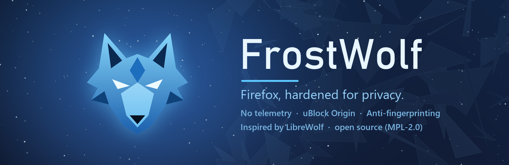

  

  
  
  

  <b>Frostwolf</b> is Firefox, built from Mozilla's own source code, with everything that watches you switched off 
  and the protections Firefox already has turned all the way up. Same web, same speed, nobody looking over your shoulder.

> [!WARNING]
> Frostwolf is a young, independent project. It's Firefox underneath, so sites work like in Firefox, but security updates reach you when Frostwolf rebuilds a new Firefox ESR (checked every day) and you install it. It doesn't update itself yet.

 

Your browser sees more of your life than almost anything else you use: what you read, what worries you, your health questions, your money, your politics, who you talk to, where you are. On the normal web, much of that is quietly collected.

- **You are the product.** Trackers embedded in most websites follow you from site to site and build a profile that data brokers buy and sell: interests, habits, income bracket, health conditions, even guesses about your mood.
- **Profiles are used against you.** They decide which ads, prices, news and job offers you see, and they can be leaked, hacked, subpoenaed or sold on, long after you've forgotten the search that created them.
- **"Nothing to hide" isn't the point.** Privacy is what lets you look things up, change your mind and be yourself without being judged, scored or manipulated. When people know they're watched, they hold back.
- **It protects your security too.** Less data collected means less to steal, fewer ways to impersonate you, and fewer scams aimed precisely at you.
- **It's a right.** Privacy is recognised as a fundamental right (Article 12 of the Universal Declaration of Human Rights, Articles 7 and 8 of the EU Charter of Fundamental Rights). Your browser should respect it by default, not hide it in a settings menu.

Frostwolf's answer: collect nothing, block the trackers, look like everyone else, and forget everything when you close it.

 

| Feature | What it means for you |
|---|---|
| 🦊 **Real Firefox** | **Firefox ESR**, the long-term-support Firefox that Tor Browser and Mullvad Browser are also built on, compiled from Mozilla's source tarball and verified against Mozilla's SHA-512 checksums. Every site that works in Firefox works here. |
| 🚫 **Nothing phones home** | No telemetry, studies, crash reports, sponsored content or Pocket, and no Mozilla updater or crash reporter compiled in. |
| 🛡️ **Trackers and ads blocked** | **uBlock Origin** installed on first start, tracking protection on *Strict*, Total Cookie Protection, tracking parameters stripped from links, Global Privacy Control. |
| 👤 **You look like everyone else** | Firefox's *resist fingerprinting* mode (the same protection Tor Browser and Mullvad Browser use), letterboxing, WebGL off, no local IP leaks over WebRTC. |
| 🧹 **Forgets you on close** | Cookies, site data, cache and history are wiped when you close Frostwolf (you can change that in Settings > Privacy). |
| 🔒 **Safer connections** | HTTPS-only mode, no prefetching or speculative connections, CRLite certificate checks instead of per-site OCSP pings, punycode shown for look-alike domains, no scripts in PDFs. |
| 🔎 **Private search** | DuckDuckGo by default, with Brave Search, Mojeek and Qwant. Google, Bing, Amazon and eBay are removed. |
| ❄️ **Ice-blue look** | An original wolf logo and a dark ice-blue built-in theme. |
| 🦀 **Rust inside** | Firefox's Rust components are where much of its speed and safety comes from: **Stylo** styles pages on all your CPU cores in parallel, **WebRender** draws them on your GPU, and Rust's memory safety protects the media parsers, text encoding and URL parsing that handle untrusted data from the web. Frostwolf builds all of them in. (Most of Firefox is still C++; for a browser written entirely in Rust, see Frostwolf's sibling [RustWolf](https://github.com/anyrustslop/rustwolf).) |

Every setting is plain text you can review: [`frostwolf.cfg`](build/settings/frostwolf.cfg) and [`policies.json`](build/settings/policies.json). DRM (Netflix, Spotify Web…) is off by default; turn it on in Settings > General > *Play DRM-controlled content*.

 

Get the latest version from the **[releases page](https://github.com/anyrustslop/frostwolf/releases/latest)**:

| File | What it is |
|---|---|
| `Frostwolf-<version>-win64-setup.exe` | Installer for your Windows user (no admin rights needed). Adds Start menu and desktop shortcuts; uninstall from Settings > Apps. |
| `Frostwolf-<version>-win64-portable.zip` | Portable: unzip anywhere and run `frostwolf.exe`. |
| `SHA256SUMS.txt` | Checksums to verify your download. |

The files aren't code-signed (that costs money every year), so Windows SmartScreen may warn you: click **More info > Run anyway**. To verify a download, compare `Get-FileHash <file>` with `SHA256SUMS.txt`, or check it was built by this repository's workflow with `gh attestation verify <file> --repo anyrustslop/frostwolf`.

 

Frostwolf is built entirely in the open by [GitHub Actions](.github/workflows/build.yml), the same way for every release:

1. **Source:** [`fetch_source.py`](build/fetch_source.py) downloads Firefox ESR from `archive.mozilla.org` and refuses it unless its SHA-512 matches Mozilla's published checksum.
2. **Branding:** [`apply_branding.py`](build/branding/apply_branding.py) turns Firefox's unofficial branding into Frostwolf's, with the logo generated in code ([`logo.py`](build/branding/logo.py)) at every size.
3. **Compile:** `./mach build` with [`mozconfig`](build/mozconfig), cross-compiling for Windows x64 on Linux the way Mozilla's own build servers do.
4. **Package:** [`package.py`](build/package.py) adds the settings, policies and theme; [`installer.nsi`](build/installer.nsi) makes the installer; checksums and signed build provenance are published with the release.

Every day, the workflow checks for a new Firefox ESR and publishes a new Frostwolf when Mozilla ships security fixes.

The source code lives on **[Codeberg](https://codeberg.org/anyrustslop/frostwolf)**, a non-profit, community-run home for free software. This GitHub repository is its mirror, used for the builds and downloads.

 

Frostwolf is inspired by **[LibreWolf](https://librewolf.net)**, the community project that showed a hardened, telemetry-free Firefox can be everyone's everyday browser. Its approach (Mozilla's source, privacy-first defaults, uBlock Origin built in, cookies forgotten on close) is the model Frostwolf follows, and many of Frostwolf's settings follow LibreWolf's choices. Thank you to the LibreWolf team and contributors. 🐺

Where Frostwolf differs: it's built on **Firefox ESR** (like Tor Browser and Mullvad Browser) rather than the regular Firefox release, it ships its own ice-blue look and private search engines, and it's a much smaller, younger project. **If you want the mature, proven option, use LibreWolf.** Frostwolf is not affiliated with or endorsed by LibreWolf.

 

---

   
  MPL-2.0, like Firefox. Firefox is a trademark of the Mozilla Foundation; Frostwolf is not affiliated with or endorsed by Mozilla. 
  Sibling project: <a href="https://github.com/anyrustslop/rustwolf">RustWolf</a>, the all-Rust browser on the Servo engine.

